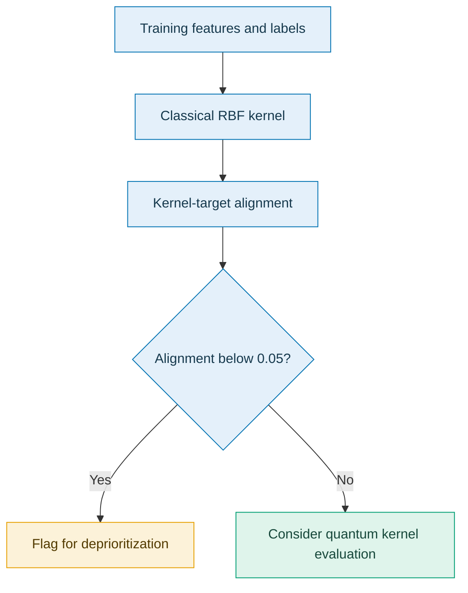
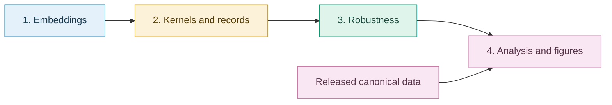
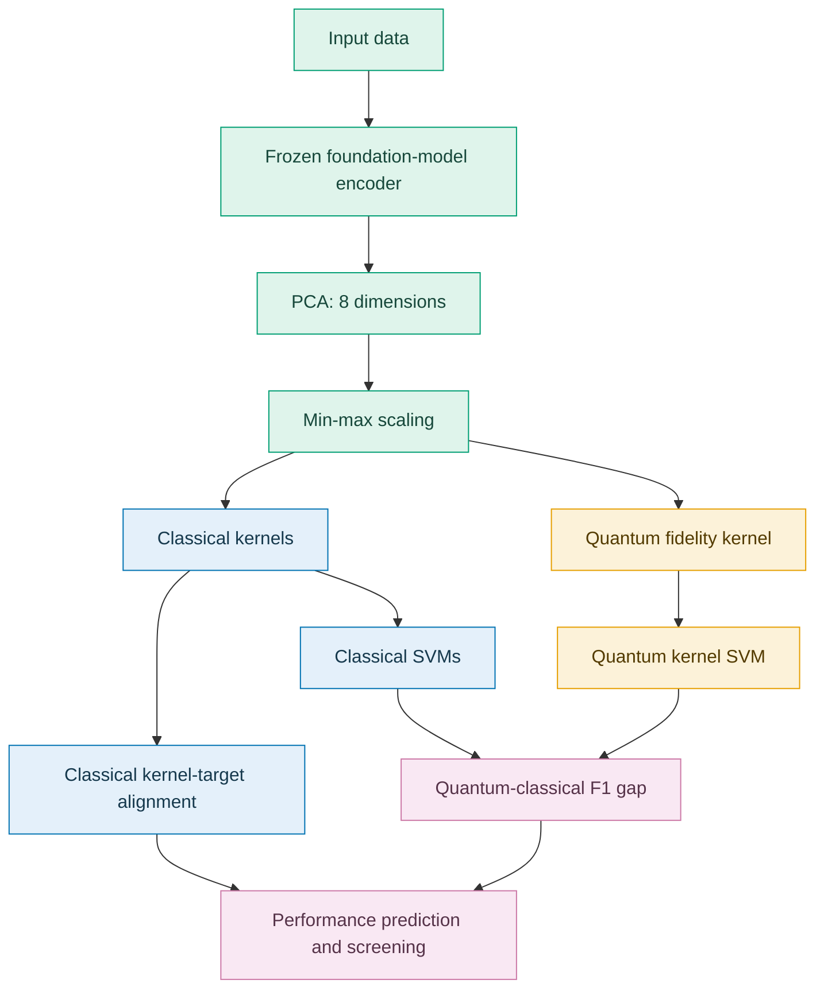

<div align="center">

# Before the First Circuit

**Zero-Shot Quantum Kernel Selection on Foundation Models with Kernel-Target Alignment**

Mohd. Farhan Israk Soumik ·Ahmed Imteaj· Abdur R. Shahid

[](#citation)
[](#experimental-grid)
[](#method)
[](#tests)
[](#quick-start)

[Quick start](#quick-start) · [Screening rule](#screening-rule) · [Results](#key-results) · [Reproduction](#reproduce-the-paper) · [Repository](#repository-structure) · [Citation](#citation)

</div>

---

## Overview

Can we anticipate whether a quantum kernel will underperform a classical alternative **before evaluating a quantum circuit**?

This repository investigates that question using frozen foundation-model embeddings and classical kernel-target alignment. The diagnostic uses training features and labels, requires no quantum resources, and takes under a second in the reported setting.

## Screening rule

```python
from qks.diagnostics import classical_alignment

A_C = classical_alignment(X_train, y_train)

if A_C < 0.05:
    print("Flagged: deprioritize quantum kernel evaluation")
else:
    print("Not flagged: further evaluation may be warranted")
```

> [!IMPORTANT]
> The reference threshold is an empirical screening criterion, not a guarantee of quantum underperformance. A configuration that is not flagged is not predicted to achieve quantum advantage. The rule uses labeled training data; it is not zero-shot classification.



## Key results

| Main-grid configurations | Multilingual configurations | Flagged main-grid configurations | Pairwise evaluations potentially avoided |
| :---: | :---: | :---: | :---: |
| 18 | 12 | 8 | ~4 million |

All eight flagged main-grid configurations exhibited negative observed performance gaps at the reference threshold. Skipping these configurations would avoid about eleven hours of the original pairwise simulation procedure. This is not a hardware-runtime measurement, and negative point estimates are not necessarily statistically significant losses.

<details>
<summary><strong>What do the screening regions mean?</strong></summary>

<br>

| Classical alignment | Interpretation in the evaluated regime |
|---|---|
| Below 0.03 | Observed deficits in the evaluated configurations |
| 0.03–0.08 | Inconclusive region |
| Above 0.08 | No statistically significant deficit observed |

The graded regions were derived from the observed results and are exploratory. The reference threshold of 0.05 is used in the main screening analysis. Neither high alignment nor absence of a significant deficit establishes equivalence or quantum advantage.

</details>

<details>
<summary><strong>What can the rule not establish?</strong></summary>

<br>

- It is primarily a task-level diagnostic, not an encoder-selection criterion.
- It is calibrated for the evaluated feature maps, sample size and preprocessing settings.
- It cannot establish whether a quantum feature map captures structure inaccessible to the classical diagnostic.
- The multilingual block was excluded from regression fitting but informed threshold selection.

</details>

[Back to top](#before-the-first-circuit)

---

## Quick start

Choose what you want to reproduce:

| I want to… | Start here | GPU |
|---|---|---|
| Verify the canonical results | [Verification](#verify-the-installation) | No |
| Run the statistical analysis | [Canonical analysis](#canonical-analysis) | No |
| Rebuild embeddings, kernels and results | [Full pipeline](#reproduce-the-paper) | Embedding extraction |
| Inspect the implementation | [Repository structure](#repository-structure) | No |

### Verify the installation

Clone the repository and install the required dependencies.

```bash
git clone <repository-url>
cd qkernel-screening
pip install -r requirements.txt
python scripts/00_verify_install.py
```

The verification script runs from the canonical files in [`data/`](data/). After installation, it needs neither a GPU nor a network connection or downloaded embeddings.

The expected output is:

```text
ALL 17 CHECKS PASSED. This installation reproduces the paper.
```

This verifies the scripted checks against the released records; it is not a rerun of all embedding extraction and kernel experiments.

### Canonical analysis

```bash
python scripts/05_analysis.py
```

Use this route to inspect the full statistical analysis without generating embeddings or recomputing kernels.

[Back to top](#before-the-first-circuit)

---

## Reproduce the paper

The full experimental pipeline contains four stages. Expand each stage to see its commands, requirements and expected outputs.



<details open>
<summary><strong>Stage 1 — Extract embeddings (GPU and network, approximately 30–60 minutes)</strong></summary>

<br>

```bash
pip install -r requirements-extract.txt
python scripts/01_extract_embeddings.py
```

Downloads datasets, runs the frozen encoders and writes `data/<tag>_seed42_raw.npz`. Existing configurations are skipped, so interrupted runs can be restarted.

For the full seed study, generate the additional embeddings with:

```bash
python scripts/01_extract_embeddings.py --seeds 42 7 123
```

**Entry point:** [`01_extract_embeddings.py`](scripts/01_extract_embeddings.py)

</details>

<details>
<summary><strong>Stage 2 — Compute kernels and records (CPU, a few minutes)</strong></summary>

<br>

```bash
python scripts/02_compute_kernels.py
```

Applies the fixed preprocessing, constructs the quantum kernel, fits the three classical baseline SVMs and quantum SVM, and writes a record for each configuration containing F1 scores, utility gap, bootstrap interval and diagnostics.

**Entry point:** [`02_compute_kernels.py`](scripts/02_compute_kernels.py)

</details>

<details>
<summary><strong>Stage 3 — Feature-map and seed robustness</strong></summary>

<br>

```bash
python scripts/03_ablation_featuremaps.py
python scripts/04_seed_study.py
```

The feature-map ablation evaluates six kernel settings (approximately 15 minutes). The seed study requires embeddings for seeds 42, 7 and 123 from Stage 1.

**Entry points:**

- [`03_ablation_featuremaps.py`](scripts/03_ablation_featuremaps.py)
- [`04_seed_study.py`](scripts/04_seed_study.py)

</details>

<details>
<summary><strong>Stage 4 — Analyze results and regenerate figures</strong></summary>

<br>

```bash
# Analyze your own computed records
python scripts/05_analysis.py --from-records

# Analyze the released canonical files
python scripts/05_analysis.py

# Regenerate all figures
for f in figures/*.py; do python "$f"; done
```

**Entry points:**

- [`05_analysis.py`](scripts/05_analysis.py)
- [`figures/`](figures/)

</details>

Reported runtimes are approximate and machine-dependent. The first stage is the documented GPU-dependent stage; the canonical analysis can bypass it entirely.

[Back to top](#before-the-first-circuit)

---

## Experimental grid

<details open>
<summary><strong>Main grid — 18 configurations</strong></summary>

<br>

Six datasets across three domains, each paired with three frozen encoders. This block is used to fit the predictive models and establish the headline main-grid results.

| Domain | Datasets | Encoders |
|---|---|---|
|  | SST-2, AG News | BERT, RoBERTa, MiniLM |
|  | CIFAR-10, Fashion-MNIST | CLIP, DINOv2, ViT |
|  | MSCOCO, SNLI-VE | CLIP, SigLIP, FLAVA (joint) |

</details>

<details>
<summary><strong>Multilingual block — 12 configurations</strong></summary>

<br>

Three-class sentiment classification in six languages under mBERT and XLM-R.

| Language | Code |
|---|---|
| Arabic | ar |
| Chinese | zh |
| English | en |
| German | de |
| Hindi | hi |
| Spanish | es |

The regression models are not fitted on this block.

**Note:** The reference threshold of 0.05 was fixed during development using configurations that included this block. Its regression evaluation is out of sample, but threshold performance here is a consistency check rather than independent threshold validation.

</details>

**Grid definition:** [`qks/config.py`](qks/config.py)

**Canonical split:** [`data/grid_split.json`](data/grid_split.json)

---

## Method

<details>
<summary><strong>Fixed classification pipeline</strong></summary>

<br>



1. Extract embeddings from a frozen encoder without updating its weights.
2. Reduce the features to eight PCA components, one per input qubit, fitting PCA on the training data.
3. Apply min-max scaling to `[0, pi]` fitted on the training data; clip test features to the same range.
4. Use the fixed-seed selection of 1,000 training and 200 test samples.
5. Evaluate an eight-qubit, single-layer IQP fidelity kernel with a linear chain of ZZ interactions on an exact statevector simulator.
6. Fit linear, RBF and polynomial SVMs on identical features and a quantum SVM on the precomputed quantum Gram matrix, all using `C = 1`.

### Utility gap

```text
Delta = F1_quantum - max(F1_linear, F1_rbf, F1_poly)
```

The maximum is taken over the observed classical test-set F1 scores. This is a conservative retrospective comparison, not validation-based model selection; it may favor the classical baseline.

**Implementation:**

[`features.py`](qks/features.py) · [`kernels.py`](qks/kernels.py) · [`evaluate.py`](qks/evaluate.py)

</details>

<details>
<summary><strong>Why kernel construction takes seconds in the released implementation</strong></summary>

<br>

The original pairwise evaluation procedure took approximately 83 minutes for a training matrix at N = 1,000. On an exact simulator, each feature-map state can instead be computed once and the matrix assembled with a matrix product:

```text
K(x, x') = |<phi(x')|phi(x)>|^2
phi(x)   = U(x)|0>
```

Both procedures give the same exact fidelity kernel up to numerical precision.

The function `qks.kernels.self_check()` and regression tests check agreement for every feature map.

The 83-minute runtime refers to the original pairwise simulator implementation, not measured runtime on quantum hardware or an unavoidable simulation cost.

**Implementation:** [`qks/kernels.py`](qks/kernels.py)

</details>

[Back to top](#before-the-first-circuit)

---

## Repository structure

<details open>
<summary><strong>Core package — qks/</strong></summary>

<br>

| File | Responsibility |
|---|---|
| [`config.py`](qks/config.py) | Configuration grid, constants and figure palette |
| [`datasets.py`](qks/datasets.py) | Seven dataset loaders and original sampling |
| [`encoders.py`](qks/encoders.py) | Frozen encoder implementations and version guards |
| [`features.py`](qks/features.py) | PCA, scaling and fixed sampling |
| [`kernels.py`](qks/kernels.py) | Four feature maps and six kernel settings |
| [`diagnostics.py`](qks/diagnostics.py) | Alignment, concentration and geometric difference |
| [`evaluate.py`](qks/evaluate.py) | Baselines, utility gap and bootstrap intervals |
| [`analysis.py`](qks/analysis.py) | Correlation, permutation, transfer and screening analyses |
| [`io.py`](qks/io.py) | Artifact input/output |

</details>

<details>
<summary><strong>Experiment scripts — scripts/</strong></summary>

<br>

| Script | Purpose |
|---|---|
| [`00_verify_install.py`](scripts/00_verify_install.py) | Verify canonical statistics |
| [`01_extract_embeddings.py`](scripts/01_extract_embeddings.py) | Extract frozen embeddings |
| [`02_compute_kernels.py`](scripts/02_compute_kernels.py) | Compute kernels and configuration records |
| [`03_ablation_featuremaps.py`](scripts/03_ablation_featuremaps.py) | Compare six quantum kernel settings |
| [`04_seed_study.py`](scripts/04_seed_study.py) | Evaluate seed variability |
| [`05_analysis.py`](scripts/05_analysis.py) | Produce the analysis report |

</details>

<details>
<summary><strong>Data, plotting and exploratory material</strong></summary>

<br>

| Directory | Contents |
|---|---|
| [`data/`](data/) | Canonical result files |
| [`figures/`](figures/) | Figure generation scripts |
| [`tests/`](tests/) | Regression tests |
| [`notebooks/`](notebooks/) | Original exploratory notebooks |

</details>

<details>
<summary><strong>Complete directory tree</strong></summary>

<br>

```text
qkernel-screening/
│
├── qks/
│   ├── config.py
│   ├── datasets.py
│   ├── encoders.py
│   ├── features.py
│   ├── kernels.py
│   ├── diagnostics.py
│   ├── evaluate.py
│   ├── analysis.py
│   └── io.py
│
├── scripts/
│   ├── 00_verify_install.py
│   ├── 01_extract_embeddings.py
│   ├── 02_compute_kernels.py
│   ├── 03_ablation_featuremaps.py
│   ├── 04_seed_study.py
│   └── 05_analysis.py
│
├── data/
│   ├── grid30_canonical.json
│   ├── grid_split.json
│   └── featuremap_ablation_all30.json
│
├── figures/
├── tests/
├── notebooks/
├── requirements.txt
├── requirements-extract.txt
├── LICENSE
└── README.md
```

</details>

---

## Data files

| Canonical file | Contents |
|---|---|
| [`grid30_canonical.json`](data/grid30_canonical.json) | All 30 configurations and their recorded fields |
| [`grid_split.json`](data/grid_split.json) | Records partitioned into `main` and `heldout` |
| [`featuremap_ablation_all30.json`](data/featuremap_ablation_all30.json) | 30 configurations under six quantum kernels |

Raw embeddings, cached kernels and generated per-run records are excluded from version control because of their size. They can be regenerated using the experimental pipeline and original data sources.

---

## Reproducibility notes

<details>
<summary><strong>MiniLM pooling and normalization</strong></summary>

<br>

The original implementation accesses MiniLM through `sentence-transformers`, which uses mean pooling and L2 normalization, unlike the first-token representations used for BERT, RoBERTa, mBERT and XLM-R.

This affects two configurations:

- SST-2 / MiniLM
- AG News / MiniLM

The revised manuscript's methodology reflects this distinction. The reported results do not need to change because of this clarification.

</details>

<details>
<summary><strong>Library-version sensitivity</strong></summary>

<br>

Re-deriving features from raw embeddings on a different scikit-learn version can result in differences of approximately `1e-5` because of randomized PCA solver behavior.

| Quantity | Observed effect |
|---|---|
| F1, utility gap and bootstrap intervals | No observed change |
| Alignment, concentration and off-diagonal similarities | Approximately `1e-7` |
| Geometric difference | Approximately `3e-3`, amplified by the regularized inverse |

</details>

<details>
<summary><strong>GPU precision and image preprocessing</strong></summary>

<br>

The encoder implementation documents two settings that matter:

- Disable TF32 using `qks.encoders.prepare_torch()` to avoid precision differences in patch embeddings.
- Load image processors with `use_fast=False` to retain the original resizing behavior rather than newer tensor-based resizing.

These settings are intended to reproduce the original runs, especially for small images upsampled to 224 × 224.

</details>

[Back to top](#before-the-first-circuit)

---

## Tests


```bash
pip install pytest
pytest
```

The documented suite contains 43 regression tests covering:

- Quantum kernel implementations.
- Mathematical properties of the diagnostics.
- Reported statistical results.
- Screening decisions.
- Configuration integrity against the released records.

The tests are designed to run without a GPU or network after dependencies are installed, taking approximately six seconds in the reported environment.

**Resources:** [`tests/`](tests/) · [`00_verify_install.py`](scripts/00_verify_install.py)

---

## Citation

If you use this repository in your research, please cite the accompanying manuscript:

```bibtex
@article{soumik2026beforethefirstcircuit,
  title  = {Before the First Circuit: Zero-Shot Quantum Kernel
            Selection on Foundation Models with
            Kernel-Target Alignment},
  author = {Soumik, Mohd. Farhan Israk and Shahid, Abdur R.},
  year   = {2026},
  note   = {Under review}
}
```

## License

See [`LICENSE`](LICENSE) for repository licensing information.

The datasets and pretrained encoders retain their original licenses and are obtained from their respective sources rather than redistributed here.

---

<div align="center">

**Before the First Circuit**

[Back to top](#before-the-first-circuit) · [Quick start](#quick-start) · [Reproduce results](#reproduce-the-paper) · [Citation](#citation)

</div>
